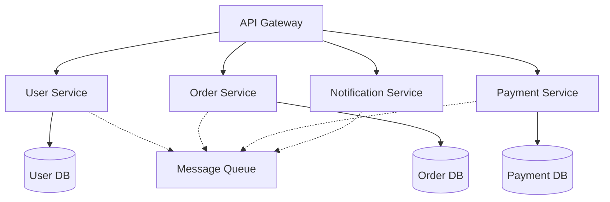

# Microservices avec Docker et Kubernetes : Guide pratique

## Introduction

L'architecture microservices combinée à la containerisation Docker et l'orchestration Kubernetes offre une solution scalable et résiliente pour les applications modernes.

## Architecture microservices

### Principes de conception

```typescript
// Définition d'un service autonome
interface MicroService {
  name: string;
  version: string;
  endpoints: ServiceEndpoint[];
  dependencies: ServiceDependency[];
  healthCheck: HealthCheckConfig;
  
  // Chaque service gère ses propres données
  database: DatabaseConfig;
  
  // Communication asynchrone privilégiée
  messaging: MessageQueueConfig;
}

class UserService implements MicroService {
  name = 'user-service';
  version = '1.2.0';
  
  async createUser(userData: UserCreateDto): Promise<User> {
    // Logique métier isolée
    const user = await this.repository.save(userData);
    
    // Publication d'événement
    await this.eventBus.publish('user.created', {
      userId: user.id,
      email: user.email
    });
    
    return user;
  }
}
```

### Décomposition par domaines métier



## Containerisation avec Docker

### Dockerfile optimisé

```dockerfile
# Multi-stage build pour optimiser la taille
FROM node:18-alpine AS builder

WORKDIR /app
COPY package*.json ./
RUN npm ci --only=production

COPY . .
RUN npm run build

# Image de production minimale
FROM node:18-alpine AS production

# Sécurité : utilisateur non-root
RUN addgroup -g 1001 -S nodejs
RUN adduser -S nextjs -u 1001

WORKDIR /app

# Copie des artefacts buildés uniquement
COPY --from=builder --chown=nextjs:nodejs /app/dist ./dist
COPY --from=builder --chown=nextjs:nodejs /app/node_modules ./node_modules
COPY --from=builder --chown=nextjs:nodejs /app/package.json ./

USER nextjs

EXPOSE 3000

# Health check intégré
HEALTHCHECK --interval=30s --timeout=3s --start-period=5s --retries=3 \
  CMD curl -f http://localhost:3000/health || exit 1

CMD ["node", "dist/main.js"]
```

### Docker Compose pour développement

```yaml
# docker-compose.dev.yml
version: '3.8'

services:
  user-service:
    build: 
      context: ./user-service
      dockerfile: Dockerfile.dev
    ports:
      - "3001:3000"
    environment:
      - NODE_ENV=development
      - DB_HOST=postgres
    volumes:
      - ./user-service:/app
      - /app/node_modules
    depends_on:
      - postgres
      - redis

  order-service:
    build: ./order-service
    ports:
      - "3002:3000"
    environment:
      - NODE_ENV=development
      - DB_HOST=postgres
      - REDIS_URL=redis://redis:6379
    depends_on:
      - postgres
      - redis

  api-gateway:
    build: ./api-gateway
    ports:
      - "8080:3000"
    environment:
      - USER_SERVICE_URL=http://user-service:3000
      - ORDER_SERVICE_URL=http://order-service:3000

  postgres:
    image: postgres:15-alpine
    environment:
      - POSTGRES_DB=microservices
      - POSTGRES_USER=devuser
      - POSTGRES_PASSWORD=devpass
    volumes:
      - postgres_data:/var/lib/postgresql/data
    ports:
      - "5432:5432"

  redis:
    image: redis:7-alpine
    ports:
      - "6379:6379"

volumes:
  postgres_data:
```

## Orchestration Kubernetes

### Déploiement d'un service

```yaml
# user-service-deployment.yaml
apiVersion: apps/v1
kind: Deployment
metadata:
  name: user-service
  namespace: microservices
  labels:
    app: user-service
    version: v1.2.0
spec:
  replicas: 3
  selector:
    matchLabels:
      app: user-service
  template:
    metadata:
      labels:
        app: user-service
        version: v1.2.0
    spec:
      containers:
      - name: user-service
        image: cybergarage/user-service:1.2.0
        ports:
        - containerPort: 3000
        env:
        - name: DB_HOST
          valueFrom:
            secretKeyRef:
              name: db-credentials
              key: host
        - name: DB_PASSWORD
          valueFrom:
            secretKeyRef:
              name: db-credentials
              key: password
        resources:
          requests:
            memory: "128Mi"
            cpu: "100m"
          limits:
            memory: "512Mi"
            cpu: "500m"
        livenessProbe:
          httpGet:
            path: /health
            port: 3000
          initialDelaySeconds: 30
          periodSeconds: 10
        readinessProbe:
          httpGet:
            path: /ready
            port: 3000
          initialDelaySeconds: 5
          periodSeconds: 5

---
apiVersion: v1
kind: Service
metadata:
  name: user-service
  namespace: microservices
spec:
  selector:
    app: user-service
  ports:
  - protocol: TCP
    port: 80
    targetPort: 3000
  type: ClusterIP
```

### Configuration avec Helm

```yaml
# values.yaml
global:
  registry: cybergarage
  namespace: microservices

services:
  userService:
    name: user-service
    image: user-service:1.2.0
    replicas: 3
    resources:
      requests:
        memory: 128Mi
        cpu: 100m
      limits:
        memory: 512Mi
        cpu: 500m
    
  orderService:
    name: order-service
    image: order-service:1.1.0
    replicas: 2
    
database:
  host: postgres-cluster.database.svc.cluster.local
  name: microservices
  
messaging:
  type: rabbitmq
  host: rabbitmq.messaging.svc.cluster.local
```

## Communication inter-services

### API Gateway avec NGINX

```nginx
# nginx.conf
upstream user-service {
    server user-service:80;
}

upstream order-service {
    server order-service:80;
}

server {
    listen 80;
    
    # Routage basé sur le path
    location /api/users {
        proxy_pass http://user-service;
        proxy_set_header X-Real-IP $remote_addr;
        proxy_set_header X-Forwarded-For $proxy_add_x_forwarded_for;
        proxy_set_header Host $http_host;
        
        # Circuit breaker
        proxy_connect_timeout 5s;
        proxy_send_timeout 60s;
        proxy_read_timeout 60s;
    }
    
    location /api/orders {
        proxy_pass http://order-service;
        proxy_set_header X-Real-IP $remote_addr;
        proxy_set_header X-Forwarded-For $proxy_add_x_forwarded_for;
        proxy_set_header Host $http_host;
    }
    
    # Rate limiting
    location /api/ {
        limit_req zone=api burst=10 nodelay;
    }
}

# Rate limiting configuration
http {
    limit_req_zone $binary_remote_addr zone=api:10m rate=10r/s;
}
```

### Service Mesh avec Istio

```yaml
# virtual-service.yaml
apiVersion: networking.istio.io/v1beta1
kind: VirtualService
metadata:
  name: user-service-vs
spec:
  http:
  - match:
    - headers:
        version:
          exact: "v2"
    route:
    - destination:
        host: user-service
        subset: v2
      weight: 100
  - route:
    - destination:
        host: user-service
        subset: v1
      weight: 100

---
apiVersion: networking.istio.io/v1beta1
kind: DestinationRule
metadata:
  name: user-service-dr
spec:
  host: user-service
  trafficPolicy:
    circuitBreaker:
      consecutiveErrors: 5
      interval: 30s
      baseEjectionTime: 30s
  subsets:
  - name: v1
    labels:
      version: v1.0.0
  - name: v2
    labels:
      version: v2.0.0
```

## Monitoring et observabilité

### Configuration Prometheus

```yaml
# prometheus-config.yaml
apiVersion: v1
kind: ConfigMap
metadata:
  name: prometheus-config
data:
  prometheus.yml: |
    global:
      scrape_interval: 15s
    
    scrape_configs:
    - job_name: 'kubernetes-pods'
      kubernetes_sd_configs:
      - role: pod
      relabel_configs:
      - source_labels: [__meta_kubernetes_pod_annotation_prometheus_io_scrape]
        action: keep
        regex: true
      - source_labels: [__meta_kubernetes_pod_annotation_prometheus_io_path]
        action: replace
        target_label: __metrics_path__
        regex: (.+)
```

### Dashboard Grafana

```json
{
  "dashboard": {
    "title": "Microservices Overview",
    "panels": [
      {
        "title": "Request Rate",
        "type": "graph",
        "targets": [
          {
            "expr": "sum(rate(http_requests_total[5m])) by (service)",
            "legendFormat": "{{service}}"
          }
        ]
      },
      {
        "title": "Error Rate",
        "type": "stat",
        "targets": [
          {
            "expr": "sum(rate(http_requests_total{status=~'5..'}[5m])) / sum(rate(http_requests_total[5m]))"
          }
        ]
      }
    ]
  }
}
```

## CI/CD Pipeline

### GitLab CI/CD

```yaml
# .gitlab-ci.yml
stages:
  - test
  - build
  - deploy

variables:
  DOCKER_DRIVER: overlay2
  REGISTRY: registry.gitlab.com/cybergarage

test:
  stage: test
  script:
    - npm ci
    - npm run test
    - npm run lint
  coverage: '/Coverage: \d+\.\d+/'

build:
  stage: build
  script:
    - docker build -t $REGISTRY/user-service:$CI_COMMIT_SHA .
    - docker push $REGISTRY/user-service:$CI_COMMIT_SHA
  only:
    - main

deploy:
  stage: deploy
  script:
    - kubectl set image deployment/user-service user-service=$REGISTRY/user-service:$CI_COMMIT_SHA
    - kubectl rollout status deployment/user-service
  only:
    - main
  when: manual
```

## Gestion des données

### Pattern Saga pour les transactions distribuées

```typescript
class OrderSaga {
  async executeOrder(orderData: OrderRequest): Promise<void> {
    const sagaId = generateSagaId();
    
    try {
      // Étape 1: Réserver le stock
      const reservation = await this.inventoryService.reserveItems(
        orderData.items, sagaId
      );
      
      // Étape 2: Traitement du paiement
      const payment = await this.paymentService.processPayment(
        orderData.payment, sagaId
      );
      
      // Étape 3: Création de la commande
      const order = await this.orderService.createOrder(
        orderData, reservation.id, payment.id
      );
      
      // Confirmation de toutes les étapes
      await this.confirmSaga(sagaId);
      
    } catch (error) {
      // Compensation en cas d'erreur
      await this.compensateSaga(sagaId);
      throw error;
    }
  }
  
  private async compensateSaga(sagaId: string): Promise<void> {
    // Annulation dans l'ordre inverse
    await this.orderService.cancelOrder(sagaId);
    await this.paymentService.refundPayment(sagaId);
    await this.inventoryService.releaseReservation(sagaId);
  }
}
```

## Bonnes pratiques

### Sécurité

```bash
# Scan de vulnérabilités avec Trivy
trivy image cybergarage/user-service:latest

# Politique de sécurité Kubernetes
kubectl apply -f - <<EOF
apiVersion: policy/v1beta1
kind: PodSecurityPolicy
metadata:
  name: restricted-psp
spec:
  privileged: false
  allowPrivilegeEscalation: false
  requiredDropCapabilities:
    - ALL
  runAsUser:
    rule: 'MustRunAsNonRoot'
  seLinux:
    rule: 'RunAsAny'
  fsGroup:
    rule: 'RunAsAny'
EOF
```

### Performance

```python
# Auto-scaling basé sur les métriques personnalisées
def configure_hpa():
    """
    Configuration Horizontal Pod Autoscaler
    """
    hpa_config = {
        'apiVersion': 'autoscaling/v2',
        'kind': 'HorizontalPodAutoscaler',
        'metadata': {'name': 'user-service-hpa'},
        'spec': {
            'scaleTargetRef': {
                'apiVersion': 'apps/v1',
                'kind': 'Deployment',
                'name': 'user-service'
            },
            'minReplicas': 2,
            'maxReplicas': 10,
            'metrics': [
                {
                    'type': 'Resource',
                    'resource': {
                        'name': 'cpu',
                        'target': {
                            'type': 'Utilization',
                            'averageUtilization': 70
                        }
                    }
                }
            ]
        }
    }
    return hpa_config
```

## Conclusion

L'architecture microservices avec Docker et Kubernetes offre une plateforme robuste et scalable. La réussite de l'implémentation dépend d'une conception soignée, d'outils d'observabilité appropriés et de bonnes pratiques DevOps.

---

*Guide technique par l'équipe CyberGarage DevOps - Expertise en architecture cloud native*